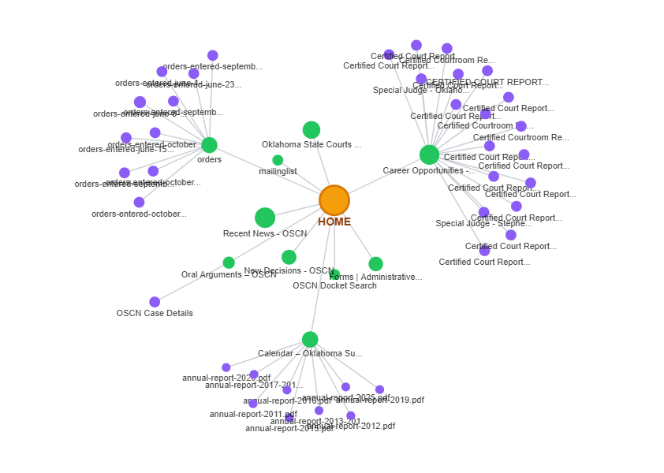

# Offline Fixtures

These small files are reserved for the local import phases. They share the same four-page example site at `https://example.test/`; the reserved `.test` domain prevents accidental use as a real public target.

- `four-page-links.csv` — directed links for the graph and CSV import checks in Phase 3 and later.
- `four-page-sitemap.xml` — URL inventory for the XML import checks in Phase 4 and later.
- `home-page.html` — local page markup with relative links for the HTML import checks in Phase 5 and later.

The fixtures are test data only. This phase does not parse or fetch them.

## Graph style reference

`sitemap-graph-reference.png` is the user-supplied visual reference for Phase 8 graph rendering and AT-09 topology/style review. Use a white canvas in place of the reference image's black background, per the user's revised preference. Preserve the prominent orange root, green first-level nodes, purple second-level nodes, thin gray links, and radial clusters around hubs. Node size varies to emphasize the root and hubs. Use readable labels and the persistent legend required by the plan; the screenshot's small text is not an accessibility target. Depth 3+ red and unknown-depth styling remain governed by the requirements.

This image is a design reference, not importable sitemap data or evidence of particular hyperlinks. Actual nodes, edges, and depths must come from the validated graph pipeline.
